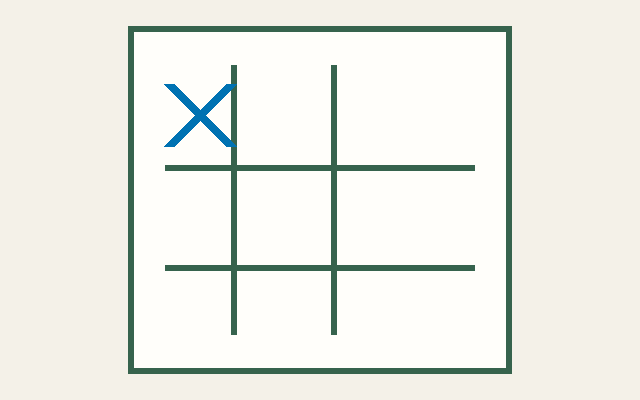

# Tabletest

**Write the rules of a board or card game, see it come alive, and test it before your players do.**

Tabletest is an open-source testbench for tabletop games. This repository implements
**Chapter 1** of the technical plan: a small TypeScript monorepo with a mutable game
contract, deterministic random number generation, Nim and Tic-tac-toe, a random bot,
sequential simulation, a first seat-advantage metric, a generic SVG table, and a
playable web demo.

> **Early development.** Rulebook examples are documentation only; there is no
> parser or compiler yet. Search bots, hidden information, worker pools, full game
> analysis, reports, themes, and the creation wizard are planned, not implemented.
> See the Spanish [technical plan](docs/PLAN.md) and
> [Chapter 1 scope](docs/PLAN.md#28-capítulo-1-lo-que-se-construye-antes-de-postular).



## Try it

Requirements: Node.js 22+ and pnpm 9+.

```bash
pnpm install
pnpm build
pnpm test
pnpm lint

pnpm tabletest sim tictactoe --games 20000 --seed demo
pnpm --filter @tabletest/web dev
```

The simulation output is reproducible for the same game, game count, and seed;
elapsed time is the only varying field. The web app lets you watch random bots
play either reference game or play against a bot. Legal choices come from each
game's move anchors, and the renderer receives only generic scene data.

## Architecture

| Package | Responsibility |
| --- | --- |
| `@tabletest/core` | `GameModule` and `Scene` contracts, sfc32/splitmix32 RNG, stable state hashing |
| `@tabletest/players` | Seeded `random` player |
| `@tabletest/games` | Handwritten Nim and Tic-tac-toe, including scenes and move anchors |
| `@tabletest/sim` | Sequential matches, derived per-game seeds, seat rotation, Wilson intervals |
| `@tabletest/cli` | `tabletest sim <nim\|tictactoe> --games N --seed S` |
| `@tabletest/render` | Game-agnostic React/SVG scene renderer with stable-id FLIP movement |
| `apps/web` | Bot-vs-bot spectator and play-vs-bot modes |

The architecture and contract rationale are recorded in
[ADR 0001](docs/adr/0001-gamemodule-and-scene.md). The Rulebook direction and
examples are in the [language overview](docs/language/overview.md); there is no
parser in this release.

## Design rules

- `apply` mutates; `clone` is independent.
- Randomness is seeded and deterministic; game state carries its sfc32 stream.
- Scene node ids remain stable across state transitions.
- The renderer knows `Scene`, not game-specific rules.
- No machine learning, analytics, accounts, user data, or network service.
- Reference implementations are traditional games or original works.

## Roadmap

Chapter 1 is the current scope. Future work—only when the author expands scope—
includes Rulebook parsing and compilation, more reference games, hidden
information, stronger classic bots, parallel simulation, additional analysis
detectors and reports, richer visual layouts, and the editor.

## License

MIT © Mateo Casciotti. See [LICENSE](LICENSE).
